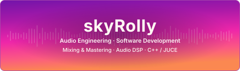

<!---
skyRolly/skyRolly is a special repository because its README.md appears on the GitHub profile.
--->

  

<h3 align="center">Selected Projects</h3>

  <a href="https://github.com/skyRolly/Anamorph"><strong>Anamorph</strong></a> · Stereo imaging and multiband width control 
  <a href="https://github.com/skyRolly/Anabasis"><strong>Anabasis</strong></a> · Mastering loudness maximizer

<h3 align="center">GitHub Activity</h3>

  <picture>
    <source media="(prefers-color-scheme: dark)" srcset="https://ghstats.dev/api/card?username=skyRolly&amp;theme=sunset&amp;border_radius=9&amp;size=compact&amp;compact_count=6&amp;custom_title=GitHub%20Stats&amp;bg=21102f&amp;text=fff1f5&amp;title_color=ff78cb&amp;icon_color=ffab78&amp;border_color=673176" />
    <source media="(prefers-color-scheme: light)" srcset="https://ghstats.dev/api/card?username=skyRolly&amp;theme=sunset&amp;border_radius=9&amp;size=compact&amp;compact_count=6&amp;custom_title=GitHub%20Stats&amp;bg=fff5f9&amp;text=441750&amp;title_color=97117e&amp;icon_color=b84652&amp;border_color=e5b4d8" />
    
  </picture>

  <picture>
    <source media="(prefers-color-scheme: dark)" srcset="https://ghstats.dev/api/langs?username=skyRolly&amp;theme=sunset&amp;border_radius=9&amp;layout=default&amp;max_langs=9&amp;bg=21102f&amp;text=fff1f5&amp;title_color=ff78cb&amp;icon_color=ffab78&amp;border_color=673176" />
    <source media="(prefers-color-scheme: light)" srcset="https://ghstats.dev/api/langs?username=skyRolly&amp;theme=sunset&amp;border_radius=9&amp;layout=default&amp;max_langs=9&amp;bg=fff5f9&amp;text=441750&amp;title_color=97117e&amp;icon_color=b84652&amp;border_color=e5b4d8" />
    
  </picture>

  <picture>
    <source media="(prefers-color-scheme: dark)" srcset="https://ghstats.dev/api/sparkline?username=skyRolly&amp;theme=sunset&amp;border_radius=9&amp;days=90&amp;width=495&amp;height=154&amp;title=Last%2090%20Days&amp;line_color=ff78cb&amp;fill_color=ee26a9&amp;bg=21102f&amp;text=fff1f5&amp;title_color=ff78cb&amp;icon_color=ffab78&amp;border_color=673176" />
    <source media="(prefers-color-scheme: light)" srcset="https://ghstats.dev/api/sparkline?username=skyRolly&amp;theme=sunset&amp;border_radius=9&amp;days=90&amp;width=495&amp;height=154&amp;title=Last%2090%20Days&amp;line_color=b51a91&amp;fill_color=ee26a9&amp;bg=fff5f9&amp;text=441750&amp;title_color=97117e&amp;icon_color=b84652&amp;border_color=e5b4d8" />
    
  </picture>

